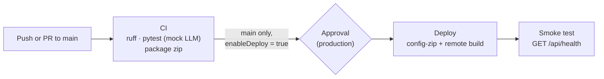

# Deployment

## Event Grid subscription for the blob trigger (Flex Consumption)

On the Flex Consumption plan, blob triggers must use Event Grid: polling is not supported. `process_incoming_blob` already uses Event Grid in Azure (leave `BLOB_TRIGGER_SOURCE` unset). Azure will not run it until an Event Grid subscription on the storage account sends `BlobCreated` events for the `incoming` container to the function's webhook.

### Before you start

- The code is deployed to the Function App and the app has started at least once. The `blobs_extension` key and the webhook endpoint exist only after that.
- `STORAGE_CONNECTION_STRING` is set and points at the storage account that has the `incoming` container. That account must be a **StorageV2 (general purpose v2)** account.
- The `Microsoft.EventGrid` resource provider is registered: **Subscriptions** > your subscription > **Settings** > **Resource providers** > search `Microsoft.EventGrid` > **Register** (skip if it already shows *Registered*).

### 1. Get the `blobs_extension` key

Portal: **Function App** > **Functions** > **App keys** > **System keys** > `blobs_extension` > click the value to show it, then copy it.

Or with the Azure CLI:

```bash
az functionapp keys list -g <RESOURCE_GROUP> -n <FUNCTION_APP_NAME> --query systemKeys.blobs_extension -o tsv
```

If `blobs_extension` is missing, the app has not loaded the blob trigger yet. Check that the deployment succeeded, open **Functions** to confirm `process_incoming_blob` is listed, then restart the app and check again.

### 2. Build the webhook URL

```
https://<FUNCTION_APP_HOST>/runtime/webhooks/blobs?functionName=Host.Functions.process_incoming_blob&code=<BLOBS_EXTENSION_KEY>
```

- `<FUNCTION_APP_HOST>`: the **Default domain** on the Function App's **Overview** page. For a classic hostname this is `<FUNCTION_APP_NAME>.azurewebsites.net`. If the app was created with a unique default hostname, it looks like `<FUNCTION_APP_NAME>-<hash>.<region>-01.azurewebsites.net`. Always copy the value shown on **Overview**.
- `process_incoming_blob` is the function name from `function_app.py`, with the `Host.Functions.` prefix.
- `<BLOBS_EXTENSION_KEY>`: the key from step 1.

Example for an app named `hr-onboarding-func`:

```
https://hr-onboarding-func.azurewebsites.net/runtime/webhooks/blobs?functionName=Host.Functions.process_incoming_blob&code=<BLOBS_EXTENSION_KEY>
```

### 3. Create the event subscription

1. Portal: open the **storage account** (the one in `STORAGE_CONNECTION_STRING`) > **Events** > **+ Event Subscription**.
2. **Basic** tab:
   - **Name**: `incoming-blob-created`
   - **Event Schema**: `Event Grid Schema`
   - **System Topic Name**: any name, e.g. `<STORAGE_ACCOUNT_NAME>-topic`. This box appears only if the storage account has no system topic yet.
   - **Filter to Event Types**: select **Blob Created** only (clear *Blob Deleted*)
   - **Endpoint Type**: `Web Hook`
   - **Endpoint**: **Configure an endpoint** > paste the URL from step 2 > **Confirm Selection**
3. **Filters** tab:
   - Tick **Enable subject filtering**
   - **Subject Begins With**: `/blobServices/default/containers/incoming/`

   With this filter, only uploads to `incoming` trigger the function. Blobs it moves into `passports`, `driving-licences` and `employee-documents` do not.
4. Click **Create**. Event Grid then sends a validation request to the webhook, and the blob extension answers it automatically. If creation fails at this step, check the URL (host, function name and key) and confirm the app is running.

### 4. Check that it works

1. Upload a file to the `incoming` container. For example, use **Storage browser**, or run `python upload_samples.py` with `STORAGE_CONNECTION_STRING` set to the Azure account.
2. Open **Function App** > **Log stream** (or **Functions** > `process_incoming_blob` > **Invocations**). You should see an invocation within a few seconds.
3. The file should move out of `incoming` into its routed container, unless it was marked `NeedsReview`. A row should appear in `ClassificationResults`.
4. On the storage account, **Events** > the subscription > **Metrics** shows delivered and failed events if nothing arrives.

## Azure DevOps CI/CD

The code lives on GitHub. Azure Pipelines builds and deploys it from [azure-pipelines.yml](azure-pipelines.yml).



- **CI** runs on every push and pull request to `main`: lint with ruff, run pytest with `LLM_PROVIDER=mock`, publish test results and coverage, and publish `functionapp.zip` as the `drop` artifact. CI needs no Azurite, Azure SQL, LLM or secrets. The zip holds only runtime files (everything not listed in `.funcignore`); Python packages are installed in Azure by a remote build.
- **CD** runs only for pushes to `main` when CI passed and `enableDeploy` is `true`. It waits for approval on the `production` environment, deploys with `az functionapp deployment source config-zip --build-remote true`, then calls `GET /api/health` (up to 10 tries, 15 seconds apart) and fails if the response is not `{"status": "ok"}`. The function key for that call is read with the Azure CLI at runtime and masked in the log; it is never stored in the pipeline.

The deployment uses the Azure CLI instead of the `AzureFunctionApp@2` task because that task has no remote-build option on Flex Consumption, and Microsoft recommends a remote build for Python.

### 1. Create the service connection

The pipeline expects a service connection named exactly **`sc-hr-onboarding`**. The name is hard-coded in `azure-pipelines.yml` (it is not a secret). If you use a different name, change `azureServiceConnection` there too.

1. Azure DevOps: **Project settings** > **Service connections** > **New service connection** > **Azure Resource Manager** > **Next**.
2. **Identity type**: `App registration (automatic)`.
3. **Credential**: `Workload identity federation`. No secret is created or has to be rotated.
4. **Scope level**: `Subscription`. Pick your subscription, then **Resource group**: `rg-hr-onboarding`.
5. **Service connection name**: `sc-hr-onboarding`.
6. Leave **Grant access permission to all pipelines** cleared. You authorise this pipeline on its first run instead (section 4).
7. **Save**.

Azure DevOps gives the connection's identity the **Contributor** role on `rg-hr-onboarding` only. That covers deploying the zip and reading the function key for the smoke test. If the deployment storage account for the Flex app is in a different resource group, also give the identity access there.

### 2. Update the variable group

**Pipelines** > **Library** > **`hr-onboarding-settings`**. The pipeline reads three variables:

| Variable | Example | Purpose |
|---|---|---|
| `functionAppName` | `hr-onboarding-func` | The Flex Consumption Function App |
| `resourceGroup` | `rg-hr-onboarding` | Its resource group |
| `enableDeploy` | `true` | `false` runs CI only and skips the CD stage |

If the group still has an `azureServiceConnection` variable, delete it. The pipeline no longer reads it.

Under **Pipeline permissions**, add this pipeline (or approve it on the first run). None of these values are secrets.

### 3. Create the environment and pipeline

1. **Pipelines** > **Environments**: open `production` and check that **Approvals and checks** has your approval. The CD stage uses this environment.
2. **Pipelines** > **New pipeline** > **GitHub (YAML)**. Sign in to GitHub if asked and select this repository.
3. **Configure your pipeline** > **Existing Azure Pipelines YAML file** > branch `main`, path `/azure-pipelines.yml` > **Continue**.
4. **Run**. Pull request builds are enabled by the `pr:` section; to also block merges on CI, add a GitHub branch protection rule for `main` that requires the Azure Pipelines check.

### 4. Approve the production deployment

1. On the first run, the run page may show **This pipeline needs permission to access resources**. Select **View** > **Permit** for the variable group, the `sc-hr-onboarding` service connection and the `production` environment.
2. When CI passes, the **Deploy to production** stage shows **Waiting**. Select **Review** > **Approve** (add a comment if you like).
3. The stage deploys and runs the smoke test. The **Smoke test /api/health** step log ends with `Health check passed`.

If the smoke test fails, check **Function App** > **Log stream** and the **Deploy zip (remote build)** step log. A missing app setting, for example `SQL_CONNECTION_STRING`, does not affect `/api/health`, because that endpoint never builds the service.
